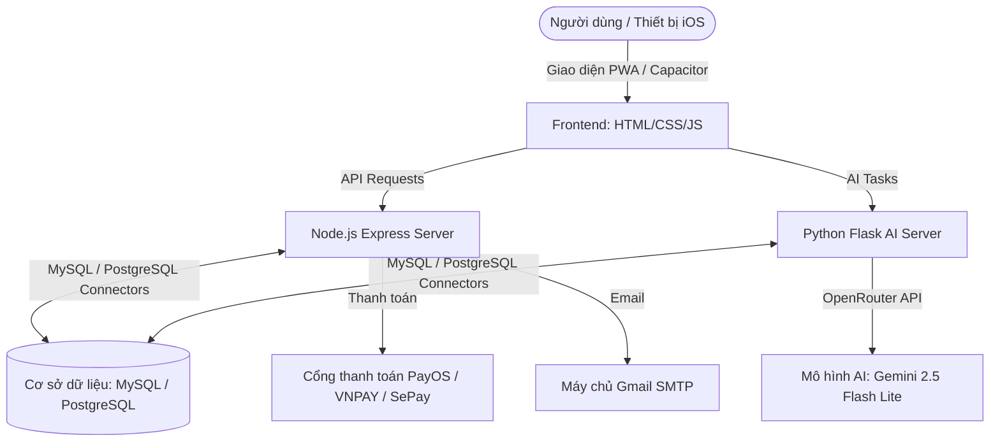

# Tài liệu Thông tin Thư viện và Công nghệ - AI Screenplay

Tài liệu này tổng hợp toàn bộ các công nghệ, ngôn ngữ, thư viện và kiến trúc hệ thống được sử dụng trong dự án **AI Screenplay Studio** (bao gồm cả Web Application và Mobile Wrapper).

---

## 1. Tổng quan Kiến trúc Hệ thống

Hệ thống được thiết kế theo mô hình **Client - Multi-Service**:
* **Frontend**: Phát triển dưới dạng Single-Page Application (SPA) viết bằng công nghệ Web truyền thống kết hợp Service Worker (PWA), đồng thời sử dụng **Capacitor** để biên dịch thành ứng dụng native trên nền tảng **iOS**.
* **Backend chính (Node.js)**: Chịu trách nhiệm quản lý tài khoản người dùng, phân quyền (JWT), xử lý thanh toán (PayOS, VNPAY, SePay), gửi email (Nodemailer) và thao tác cơ sở dữ liệu chung.
* **Backend AI (Python API)**: Chạy song song máy chủ Flask chuyên trách tương tác với API OpenRouter để gọi các mô hình LLM sinh kịch bản và xử lý logic nhân vật/cốt truyện.
* **Cơ sở dữ liệu (Database)**: Hỗ trợ linh hoạt song song **MySQL** và **PostgreSQL**, tích hợp cơ chế tự động chuyển dịch truy vấn và đồng bộ hóa dữ liệu.

---

## 2. Chi tiết các Công nghệ & Thư viện sử dụng

### 2.1. Frontend (Giao diện người dùng & Mobile Wrapper)

Giao diện được xây dựng tối giản, trực quan và hiện đại theo phong cách **Glassmorphism**, tập trung vào trải nghiệm mượt mà trên cả trình duyệt và ứng dụng di động.

| Công nghệ / Thư viện | Phiên bản | Vai trò & Mục đích sử dụng |
| :--- | :--- | :--- |
| **HTML5 / CSS3 / JavaScript (ES6+)** | Tiêu chuẩn | Xây dựng khung giao diện, kiểu dáng (CSS tùy chỉnh không dùng framework lớn) và logic xử lý giao diện phía máy khách. |
| **Google Fonts (Inter)** | CDN | Cung cấp kiểu chữ (Typography) hiện đại, sạch sẽ cho ứng dụng. |
| **Font Awesome** | `6.4.0` | Bộ thư viện icon trực quan hiển thị trên sidebar, toolbar và các nút thao tác. |
| **docx** | `7.8.2` | Thư viện JavaScript chạy trực tiếp ở Client, giúp tạo lập cấu trúc và tải xuống tệp tin Microsoft Word (.docx) chứa kịch bản trực tiếp từ trình duyệt mà không cần xử lý ở server. |
| **Capacitor Core & CLI** | `^6.0.0` | Bộ công cụ đóng gói và cầu nối giúp chạy ứng dụng Web trên nền tảng iOS của Apple, cho phép tương tác với API thiết bị. |
| **Capacitor iOS** | `^6.0.0` | Thư viện runtime của Capacitor phục vụ riêng cho môi trường iOS (Xcode). |
| **Service Worker & PWA Support** | Tiêu chuẩn | Hỗ trợ cài đặt ứng dụng lên màn hình chính điện thoại, lưu cache offline tài nguyên tĩnh giúp tải trang nhanh hơn. |

---

### 2.2. Backend chính (Node.js Server)

Dịch vụ Node.js chịu trách nhiệm quản lý luồng dữ liệu nghiệp vụ, xác thực người dùng và tích hợp các cổng thanh toán.

| Thư viện | Phiên bản | Vai trò & Mục đích sử dụng |
| :--- | :--- | :--- |
| **express** | `^4.18.2` | Framework xây dựng RESTful API chính cho hệ thống. |
| **mysql2** | `^3.6.5` | Trình điều khiển kết nối cơ sở dữ liệu MySQL, hỗ trợ cơ chế Async/Await (Promise). |
| **pg** | `^8.21.0` | Client kết nối cơ sở dữ liệu PostgreSQL và quản lý Connection Pool. |
| **Bộ dịch chuyển DB (`database.js`)** | Custom | Lớp kết nối tự động phát hiện loại DB (`DB_TYPE`), biên dịch cú pháp SQL của MySQL sang PostgreSQL theo thời gian thực (ví dụ chuyển đổi `ON DUPLICATE KEY UPDATE`, hàm thời gian, placeholder `?` sang `$1`), đồng thời tự động nhân bản đồng bộ dữ liệu từ MySQL sang PostgreSQL khi khởi chạy. |
| **jsonwebtoken** | `^9.0.3` | Tạo và xác thực mã thông báo (JWT Token) để duy trì trạng thái đăng nhập của người dùng. |
| **bcrypt / bcryptjs** | `^5.1.1` / `^3.0.3` | Mã hóa bảo mật một chiều mật khẩu người dùng trước khi lưu vào cơ sở dữ liệu. |
| **google-auth-library** | `^9.14.1` | Thư viện xác thực token Google OAuth 2.0 phía máy chủ phục vụ tính năng "Đăng nhập bằng Google". |
| **@payos/node** | `^2.0.5` | SDK chính thức của PayOS để tạo link thanh toán, xử lý Webhook và đối soát giao dịch nạp tiền tự động. |
| **sepay-pg-node** | `^1.0.0` | Thư viện tích hợp nhận diện và xử lý biến động số dư qua SePay. |
| **multer** | `^2.1.1` | Middleware xử lý tải lên tệp tin định dạng `multipart/form-data` (phục vụ upload truyện/văn bản gốc). |
| **nodemailer** | `^9.0.0` | Thư viện gửi email thông qua giao thức SMTP (dùng tài khoản Gmail App Password gửi thông báo). |
| **cors** | `^2.8.5` | Cấu hình cho phép chia sẻ tài nguyên giữa các nguồn khác nhau (Cross-Origin Resource Sharing). |
| **dotenv** | `^16.3.1` | Đọc các cấu hình môi trường bảo mật từ file `.env` vào `process.env`. |
| **nodemon** | `^3.0.2` | Công cụ tự động khởi động lại Node.js server khi phát hiện thay đổi trong mã nguồn (dành cho môi trường phát triển). |

---

### 2.3. Backend AI (Python API)

Dịch vụ Python chịu trách nhiệm điều phối toàn bộ các yêu cầu sinh nội dung AI, xử lý cấu trúc prompt và chạy các thuật toán tối ưu hóa kịch bản.

| Thư viện | Phiên bản | Vai trò & Mục đích sử dụng |
| :--- | :--- | :--- |
| **Flask** | `3.0.0` | Micro-framework xây dựng các endpoint dịch vụ sinh kịch bản AI gọn nhẹ. |
| **flask-cors** | `4.0.0` | Cấu hình CORS riêng cho máy chủ Flask để chấp nhận request từ Frontend hoặc Node.js. |
| **httpx** | `>=0.27.0` | HTTP Client hiệu năng cao dùng để gửi request bất đồng bộ (Async) tới API của OpenRouter. |
| **python-dotenv** | `1.0.0` | Nạp cấu hình từ tệp tin môi trường `.env` dùng chung của dự án. |
| **pymysql** | `1.1.1` | Trình điều khiển kết nối cơ sở dữ liệu MySQL bằng Python. |
| **psycopg2-binary** | `2.9.12` | Thư viện kết nối và làm việc với cơ sở dữ liệu PostgreSQL cho Python. |
| **OpenRouter AI Core** | Custom | Logic gửi Prompt phân cấp ngữ cảnh (Logline -> Theme -> Characters -> Synopsis -> Beats -> Scenes -> Script) tới mô hình đích **Google Gemini 2.5 Flash Lite** nhằm đảm bảo kịch bản sinh ra có độ nhất quán cao và không bị mất ngữ cảnh của các chương trước. |

---

## 3. Các Luồng Nghiệp vụ Công nghệ Chính

1. **Xác thực Đa hình thức (Hybrid Auth)**:
   * Người dùng đăng nhập bằng Email/Password (mật khẩu băm qua `bcrypt`) hoặc Google Account (verify qua Client ID và Google SDK).
   * Server Node.js cấp phát **JWT Token** lưu ở Cookie/LocalStorage của Client để xác thực các API Requests tiếp theo qua Middleware.
2. **Xử lý Chuyển đổi Cơ sở dữ liệu tự động**:
   * Nhà phát triển có thể thiết lập hệ thống chạy độc lập trên MySQL hoặc PostgreSQL.
   * Node.js tự động đồng bộ hóa cấu trúc bảng và di chuyển dữ liệu (Auto Migrate) giữa MySQL và PostgreSQL dựa theo biến cấu hình `DB_TYPE`.
3. **Gọi AI theo Chuỗi trạng thái (Stateful AI Generation)**:
   * Do độ dài kịch bản phim rất lớn, hệ thống không tạo toàn bộ kịch bản cùng lúc mà chia thành 8 bước tuần tự. Dữ liệu đầu ra của bước trước sẽ làm đầu vào (context) cho bước sau và được lưu vào cơ sở dữ liệu.
4. **Cổng thanh toán tự động (IPN / Webhooks)**:
   * Liên kết cổng **PayOS** và **VNPAY** để sinh mã QR thanh toán nhanh. Khi có giao dịch thành công, các cổng thanh toán gửi tín hiệu Webhook/IPN về Node.js server để tự động cộng tiền/nâng cấp gói cước cho tài khoản người dùng ngay lập tức.
