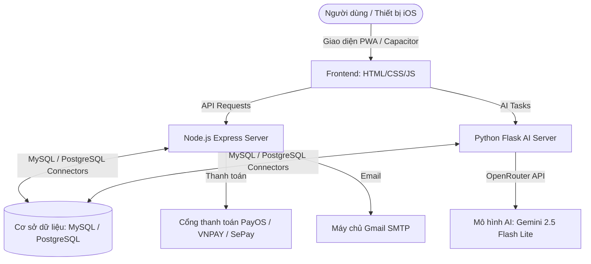

# Hướng dẫn sử dụng hệ thống AI Screenplay

Chào mừng bạn đến với **AI Screenplay** - Hệ thống hỗ trợ biên kịch chuyên nghiệp bằng Trí tuệ Nhân tạo. Tài liệu này sẽ hướng dẫn bạn toàn bộ quy trình từ đăng ký tài khoản, nạp tiền/nâng cấp gói cước, sử dụng các công cụ biên kịch, đến quản trị hệ thống dành cho Admin.

---

## 1. Đăng ký & Đăng nhập tài khoản

Hệ thống hỗ trợ bảo mật đa tầng cho người dùng:
- **Đăng nhập/Đăng ký thường**: Truy cập trang đăng nhập (`/auth.html`), nhập thông tin đăng ký tài khoản mới hoặc đăng nhập bằng Email/Mật khẩu đã tạo.
- **Đăng nhập bằng Google**: Nhấp chọn nút đăng nhập bằng tài khoản Google để liên kết tài khoản nhanh chóng và bảo mật thông qua Google OAuth.

*Sau khi đăng nhập thành công, bạn sẽ được tự động chuyển hướng về trang **Dashboard cá nhân** (`/dashboard.html`).*

---

## 2. Nâng cấp tài khoản và Nạp số dư

Hệ thống AI Screenplay sử dụng cơ chế số dư tín dụng (credits) để tính phí các lượt gọi sinh nội dung bằng AI. Để nạp thêm tín dụng hoặc nâng cấp lên gói PRO:
1. Từ trang Dashboard (`/dashboard.html`), đi tới mục **Gói dịch vụ**.
2. Chọn gói cước mong muốn (ví dụ: gói PRO Tháng, gói Nạp thêm tín dụng).
3. Hệ thống cung cấp hai phương thức thanh toán tự động:
   - **Cổng thanh toán SePay (PayOS)**: Tạo mã QR thanh toán động. Bạn chỉ cần mở ứng dụng ngân hàng quét mã QR và thực hiện chuyển khoản. Hệ thống sẽ nhận tín hiệu và cộng tiền tự động sau vài giây (IPN).
   - **Cổng thanh toán VNPAY Sandbox**: Hệ thống chuyển hướng bạn sang cổng thanh toán VNPAY, chọn thẻ nội địa hoặc quét QR VNPAY để thanh toán thử nghiệm.
4. Kiểm tra lịch sử giao dịch tại tab **Lịch sử thanh toán** để theo dõi trạng thái hóa đơn.

---

## 3. Quy trình sáng tác Kịch bản chi tiết

Hệ thống hỗ trợ 2 luồng làm việc chính để đáp ứng nhu cầu biên kịch đa dạng:

### Luồng 1: Sáng tác từ Ý tưởng sơ khởi (From Scratch)
Thích hợp khi bạn bắt đầu dự án từ một ý tưởng ngắn gọn ban đầu. Quy trình gồm 8 bước tiêu chuẩn Hollywood:

1. **Logline (Tóm tắt sơ khởi)**:
   - *Mục tiêu*: Viết 1-2 câu tóm tắt cốt lõi giới thiệu nhân vật chính, mục tiêu, và xung đột chính.
   - *Cách dùng*: Nhập mô tả ý tưởng ban đầu, nhấn "Sinh nội dung bằng AI" để nhận gợi ý Logline.
2. **Theme (Chủ đề)**:
   - *Mục tiêu*: Định hình thông điệp cốt lõi, câu hỏi kịch tính và thể loại phim.
   - *Cách dùng*: AI sẽ dựa vào Logline để đề xuất các chủ đề và ý nghĩa ẩn sâu của tác phẩm.
3. **Character Profile (Hồ sơ nhân vật)**:
   - *Mục tiêu*: Xây dựng thông tin chi tiết về các nhân vật (Ngoại hình, tính cách, động cơ, bí mật).
   - *Cách dùng*: Bạn có thể yêu cầu AI sinh hồ sơ hàng loạt hoặc tự tay thêm/sửa/xóa từng nhân vật riêng lẻ.
4. **Synopsis (Cốt truyện khái quát)**:
   - *Mục tiêu*: Viết tóm tắt diễn biến truyện dài khoảng 1-2 trang.
   - *Cách dùng*: AI tổng hợp thông tin từ Logline, Theme và danh sách Nhân vật để viết cốt truyện hoàn chỉnh.
5. **4-Act Structure (Cấu trúc 4 hồi)**:
   - *Mục tiêu*: Phân bổ cốt truyện theo cấu trúc hồi chuẩn điện ảnh (Hồi 1, Hồi 2A, Hồi 2B, Hồi 3).
   - *Cách dùng*: AI phân rã Synopsis thành các cột mốc thời gian và điểm ngoặt (Plot points) quan trọng.
6. **Beat Sheet (Phân cảnh chi tiết)**:
   - *Mục tiêu*: Xác định các nhịp câu chuyện (Beats) theo cấu trúc Save the Cat hoặc cấu trúc hồi.
   - *Cách dùng*: Phân rã cụ thể các sự kiện chính trong phim.
7. **Scene List (Danh sách phân cảnh)**:
   - *Mục tiêu*: Liệt kê danh sách tất cả các cảnh phim (Đánh số cảnh, địa điểm INT/EXT, ngày/đêm, tóm tắt cảnh).
   - *Cách dùng*: Làm khung xương để chuẩn bị viết kịch bản hội thoại chi tiết.
8. **Hollywood Script (Kịch bản Hollywood)**:
   - *Mục tiêu*: Viết kịch bản chi tiết gồm hành động, hội thoại, định dạng chuẩn Hollywood.
   - *Cách dùng*: Do kịch bản phim rất dài, hệ thống hỗ trợ sinh kịch bản theo từng phần hoặc viết tiếp nối mà không ghi đè dữ liệu cũ.

### Luồng 2: Chuyển thể từ Câu chuyện gốc (From Story)
Thích hợp khi bạn đã có sẵn một cuốn tiểu thuyết, truyện ngắn hoặc tài liệu văn bản dài và muốn chuyển thể thành kịch bản phim:

1. **Tải truyện lên (Story Upload)**:
   - Tải lên tệp tài liệu dạng `.txt`, `.pdf`, hoặc `.docx`.
   - Hệ thống sẽ tự động đọc, xử lý và trích xuất toàn bộ nội dung văn bản.
2. **Phân tích Chủ đề (Story Theme)**: Phân tích và trích xuất chủ đề chủ đạo từ truyện gốc.
3. **Phân tích Nhân vật (Story Character)**: Nhận diện và lập danh sách hồ sơ các nhân vật xuất hiện trong truyện.
4. **Viết Synopsis (Story Synopsis)**: Tạo bản tóm tắt cốt truyện tập trung vào mạch phim.
5. **Phân tích theo từng hồi (Story Structure)**: Tổ chức lại cốt truyện gốc thành cấu trúc hồi kịch tính.
6. **Tạo Beat Sheet (Story Beat Sheet)**: Xác định các nhịp phim chính dựa trên nguyên tác.
7. **Danh sách Cảnh (Story Scene List)**: Lập danh sách các phân cảnh cần triển khai.
8. **Viết Kịch bản (Story Script)**: Tạo các đoạn thoại và phân cảnh chi tiết chuẩn Hollywood dựa trên nội dung truyện gốc.

---

## 4. Quản lý dự án cá nhân

Trang **Quản lý dự án** (`/projects.html`) giúp bạn kiểm soát toàn bộ công việc:
- **Tạo dự án mới**: Nhấn "Tạo dự án mới", nhập Tiêu đề, Mô tả và chọn luồng viết (Từ ý tưởng sơ khởi hoặc Từ truyện gốc).
- **Mở dự án cũ**: Nhấp vào dự án trong danh sách để tiếp tục sáng tác. Hệ thống tự động khôi phục toàn bộ nội dung ở bước bạn đang thực hiện dở dang.
- **Xuất kịch bản**: Hỗ trợ xuất kịch bản chi tiết định dạng Markdown chất lượng cao hoặc văn bản thô để bạn sao chép và in ấn.
- **Xóa dự án**: Xóa bỏ các dự án không còn sử dụng để giải phóng không gian làm việc.

---

## 5. Hướng dẫn dành cho Quản trị viên (Admin Portal)

Nếu tài khoản của bạn được cấp quyền Quản trị viên (`is_admin = 1` trong MySQL), bạn sẽ có quyền truy cập vào giao diện quản trị nâng cao tại địa chỉ **`http://localhost:3000/admin.html`**:

### 5.1 Dashboard thống kê tổng quan
Giao diện chính hiển thị các thông số thời gian thực:
- Tổng số lượng người dùng đã đăng ký.
- Tổng số dự án kịch bản trên hệ thống.
- Biểu đồ và số liệu thống kê lượt gọi AI, thời gian phản hồi trung bình (latency).
- Chi phí token (đầu vào và đầu ra) cùng tổng chi phí gọi dịch vụ OpenRouter.

### 5.2 Quản lý người dùng
- Tìm kiếm tài khoản người dùng theo email hoặc tên.
- Khóa (Lock) hoặc mở khóa (Unlock) tài khoản người dùng vi phạm.
- Thiết lập quyền quản trị viên (`is_admin`) cho các tài khoản khác.
- Điều chỉnh trực tiếp số dư tín dụng AI của từng tài khoản người dùng để hỗ trợ nạp tiền thủ công.

### 5.3 Cấu hình Hệ thống & Khóa API
- **AI Settings**: Thay đổi API key của OpenRouter, thay đổi tên mô hình AI mặc định (ví dụ: từ `google/gemini-2.5-flash-lite` sang `anthropic/claude-3-haiku` hoặc các mô hình khác).
- **Giá Token**: Cấu hình đơn giá thanh toán của 1.000 token đầu vào (input tokens) và 1.000 token đầu ra (output tokens) để tự động trừ tiền trong ví người dùng một cách chính xác theo chi phí sử dụng thực tế.
- **Payment Gateway**: Bật/tắt và thay đổi thông số kết nối các cổng VNPAY và PayOS/SePay.

### 5.4 Quản lý Prompt hệ thống (System Prompts)
Đây là tính năng cực kỳ quan trọng giúp quản trị viên tinh chỉnh "độ thông minh" của AI:
- Bạn có thể tùy ý thay đổi prompt hệ thống cho từng công cụ trong số 9 bước biên kịch (áp dụng riêng biệt cho luồng Sáng tác mới và luồng Chuyển thể truyện gốc).
- Nhấp chọn công cụ biên kịch tương ứng, chỉnh sửa nội dung prompt tiếng Việt/tiếng Anh, sau đó bấm "Lưu Prompt". AI sẽ lập tức áp dụng chỉ dẫn mới này cho các lượt gọi tiếp theo của người dùng.

### 5.5 Quản lý Gói cước và Tài nguyên tải lên
- **Gói cước (Custom Plans)**: Thêm mới, chỉnh sửa giá tiền, số lượng credits được cộng khi mua, hoặc xóa bỏ các gói cước hiển thị trên trang Dashboard.
- **Tệp tin tải lên (Story Files)**: Giám sát toàn bộ các tệp tin truyện gốc do người dùng tải lên hệ thống. Admin có thể xóa bỏ trực tiếp các tệp tin cũ hoặc dung lượng quá lớn khỏi ổ cứng máy chủ để tiết kiệm tài nguyên lưu trữ.

# Tài liệu Thông tin Thư viện và Công nghệ - AI Screenplay

Tài liệu này tổng hợp toàn bộ các công nghệ, ngôn ngữ, thư viện và kiến trúc hệ thống được sử dụng trong dự án **AI Screenplay Studio** (bao gồm cả Web Application và Mobile Wrapper).

---

## 1. Tổng quan Kiến trúc Hệ thống

Hệ thống được thiết kế theo mô hình **Client - Multi-Service**:
* **Frontend**: Phát triển dưới dạng Single-Page Application (SPA) viết bằng công nghệ Web truyền thống kết hợp Service Worker (PWA), đồng thời sử dụng **Capacitor** để biên dịch thành ứng dụng native trên nền tảng **iOS**.
* **Backend chính (Node.js)**: Chịu trách nhiệm quản lý tài khoản người dùng, phân quyền (JWT), xử lý thanh toán (PayOS, VNPAY, SePay), gửi email (Nodemailer) và thao tác cơ sở dữ liệu chung.
* **Backend AI (Python API)**: Chạy song song máy chủ Flask chuyên trách tương tác với API OpenRouter để gọi các mô hình LLM sinh kịch bản và xử lý logic nhân vật/cốt truyện.
* **Cơ sở dữ liệu (Database)**: Hỗ trợ linh hoạt song song **MySQL** và **PostgreSQL**, tích hợp cơ chế tự động chuyển dịch truy vấn và đồng bộ hóa dữ liệu.

---

## 2. Chi tiết các Công nghệ & Thư viện sử dụng

### 2.1. Frontend (Giao diện người dùng & Mobile Wrapper)

Giao diện được xây dựng tối giản, trực quan và hiện đại theo phong cách **Glassmorphism**, tập trung vào trải nghiệm mượt mà trên cả trình duyệt và ứng dụng di động.

| Công nghệ / Thư viện | Phiên bản | Vai trò & Mục đích sử dụng |
| :--- | :--- | :--- |
| **HTML5 / CSS3 / JavaScript (ES6+)** | Tiêu chuẩn | Xây dựng khung giao diện, kiểu dáng (CSS tùy chỉnh không dùng framework lớn) và logic xử lý giao diện phía máy khách. |
| **Google Fonts (Inter)** | CDN | Cung cấp kiểu chữ (Typography) hiện đại, sạch sẽ cho ứng dụng. |
| **Font Awesome** | `6.4.0` | Bộ thư viện icon trực quan hiển thị trên sidebar, toolbar và các nút thao tác. |
| **docx** | `7.8.2` | Thư viện JavaScript chạy trực tiếp ở Client, giúp tạo lập cấu trúc và tải xuống tệp tin Microsoft Word (.docx) chứa kịch bản trực tiếp từ trình duyệt mà không cần xử lý ở server. |
| **Capacitor Core & CLI** | `^6.0.0` | Bộ công cụ đóng gói và cầu nối giúp chạy ứng dụng Web trên nền tảng iOS của Apple, cho phép tương tác với API thiết bị. |
| **Capacitor iOS** | `^6.0.0` | Thư viện runtime của Capacitor phục vụ riêng cho môi trường iOS (Xcode). |
| **Service Worker & PWA Support** | Tiêu chuẩn | Hỗ trợ cài đặt ứng dụng lên màn hình chính điện thoại, lưu cache offline tài nguyên tĩnh giúp tải trang nhanh hơn. |

---

### 2.2. Backend chính (Node.js Server)

Dịch vụ Node.js chịu trách nhiệm quản lý luồng dữ liệu nghiệp vụ, xác thực người dùng và tích hợp các cổng thanh toán.

| Thư viện | Phiên bản | Vai trò & Mục đích sử dụng |
| :--- | :--- | :--- |
| **express** | `^4.18.2` | Framework xây dựng RESTful API chính cho hệ thống. |
| **mysql2** | `^3.6.5` | Trình điều khiển kết nối cơ sở dữ liệu MySQL, hỗ trợ cơ chế Async/Await (Promise). |
| **pg** | `^8.21.0` | Client kết nối cơ sở dữ liệu PostgreSQL và quản lý Connection Pool. |
| **Bộ dịch chuyển DB (`database.js`)** | Custom | Lớp kết nối tự động phát hiện loại DB (`DB_TYPE`), biên dịch cú pháp SQL của MySQL sang PostgreSQL theo thời gian thực (ví dụ chuyển đổi `ON DUPLICATE KEY UPDATE`, hàm thời gian, placeholder `?` sang `$1`), đồng thời tự động nhân bản đồng bộ dữ liệu từ MySQL sang PostgreSQL khi khởi chạy. |
| **jsonwebtoken** | `^9.0.3` | Tạo và xác thực mã thông báo (JWT Token) để duy trì trạng thái đăng nhập của người dùng. |
| **bcrypt / bcryptjs** | `^5.1.1` / `^3.0.3` | Mã hóa bảo mật một chiều mật khẩu người dùng trước khi lưu vào cơ sở dữ liệu. |
| **google-auth-library** | `^9.14.1` | Thư viện xác thực token Google OAuth 2.0 phía máy chủ phục vụ tính năng "Đăng nhập bằng Google". |
| **@payos/node** | `^2.0.5` | SDK chính thức của PayOS để tạo link thanh toán, xử lý Webhook và đối soát giao dịch nạp tiền tự động. |
| **sepay-pg-node** | `^1.0.0` | Thư viện tích hợp nhận diện và xử lý biến động số dư qua SePay. |
| **multer** | `^2.1.1` | Middleware xử lý tải lên tệp tin định dạng `multipart/form-data` (phục vụ upload truyện/văn bản gốc). |
| **nodemailer** | `^9.0.0` | Thư viện gửi email thông qua giao thức SMTP (dùng tài khoản Gmail App Password gửi thông báo). |
| **cors** | `^2.8.5` | Cấu hình cho phép chia sẻ tài nguyên giữa các nguồn khác nhau (Cross-Origin Resource Sharing). |
| **dotenv** | `^16.3.1` | Đọc các cấu hình môi trường bảo mật từ file `.env` vào `process.env`. |
| **nodemon** | `^3.0.2` | Công cụ tự động khởi động lại Node.js server khi phát hiện thay đổi trong mã nguồn (dành cho môi trường phát triển). |

---

### 2.3. Backend AI (Python API)

Dịch vụ Python chịu trách nhiệm điều phối toàn bộ các yêu cầu sinh nội dung AI, xử lý cấu trúc prompt và chạy các thuật toán tối ưu hóa kịch bản.

| Thư viện | Phiên bản | Vai trò & Mục đích sử dụng |
| :--- | :--- | :--- |
| **Flask** | `3.0.0` | Micro-framework xây dựng các endpoint dịch vụ sinh kịch bản AI gọn nhẹ. |
| **flask-cors** | `4.0.0` | Cấu hình CORS riêng cho máy chủ Flask để chấp nhận request từ Frontend hoặc Node.js. |
| **httpx** | `>=0.27.0` | HTTP Client hiệu năng cao dùng để gửi request bất đồng bộ (Async) tới API của OpenRouter. |
| **python-dotenv** | `1.0.0` | Nạp cấu hình từ tệp tin môi trường `.env` dùng chung của dự án. |
| **pymysql** | `1.1.1` | Trình điều khiển kết nối cơ sở dữ liệu MySQL bằng Python. |
| **psycopg2-binary** | `2.9.12` | Thư viện kết nối và làm việc với cơ sở dữ liệu PostgreSQL cho Python. |
| **OpenRouter AI Core** | Custom | Logic gửi Prompt phân cấp ngữ cảnh (Logline -> Theme -> Characters -> Synopsis -> Beats -> Scenes -> Script) tới mô hình đích **Google Gemini 2.5 Flash Lite** nhằm đảm bảo kịch bản sinh ra có độ nhất quán cao và không bị mất ngữ cảnh của các chương trước. |

---

## 3. Các Luồng Nghiệp vụ Công nghệ Chính

1. **Xác thực Đa hình thức (Hybrid Auth)**:
   * Người dùng đăng nhập bằng Email/Password (mật khẩu băm qua `bcrypt`) hoặc Google Account (verify qua Client ID và Google SDK).
   * Server Node.js cấp phát **JWT Token** lưu ở Cookie/LocalStorage của Client để xác thực các API Requests tiếp theo qua Middleware.
2. **Xử lý Chuyển đổi Cơ sở dữ liệu tự động**:
   * Nhà phát triển có thể thiết lập hệ thống chạy độc lập trên MySQL hoặc PostgreSQL.
   * Node.js tự động đồng bộ hóa cấu trúc bảng và di chuyển dữ liệu (Auto Migrate) giữa MySQL và PostgreSQL dựa theo biến cấu hình `DB_TYPE`.
3. **Gọi AI theo Chuỗi trạng thái (Stateful AI Generation)**:
   * Do độ dài kịch bản phim rất lớn, hệ thống không tạo toàn bộ kịch bản cùng lúc mà chia thành 8 bước tuần tự. Dữ liệu đầu ra của bước trước sẽ làm đầu vào (context) cho bước sau và được lưu vào cơ sở dữ liệu.
4. **Cổng thanh toán tự động (IPN / Webhooks)**:
   * Liên kết cổng **PayOS** và **VNPAY** để sinh mã QR thanh toán nhanh. Khi có giao dịch thành công, các cổng thanh toán gửi tín hiệu Webhook/IPN về Node.js server để tự động cộng tiền/nâng cấp gói cước cho tài khoản người dùng ngay lập tức.
