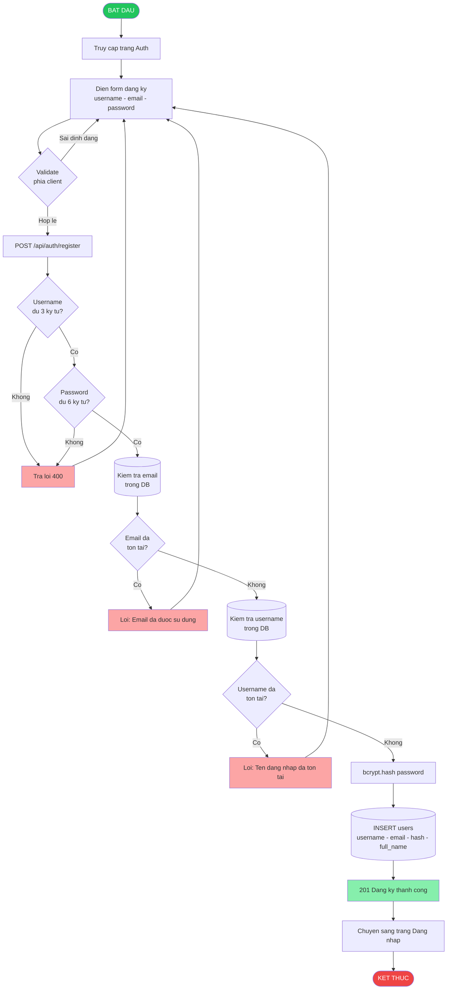
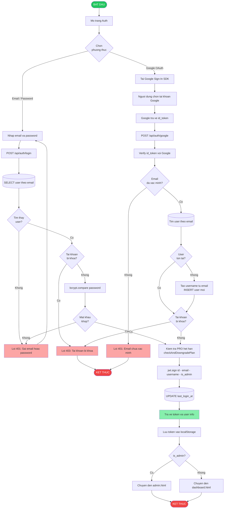
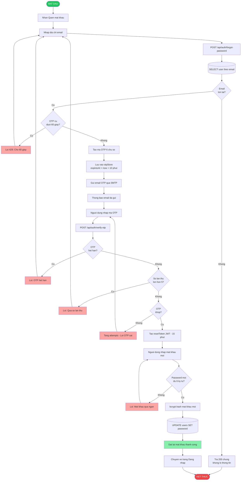
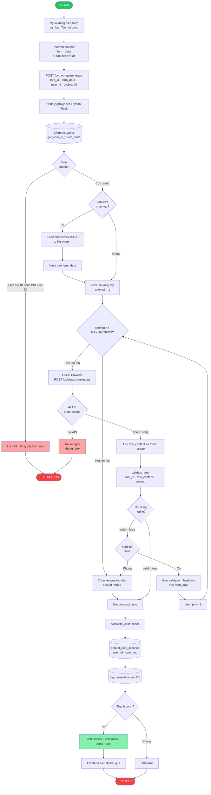
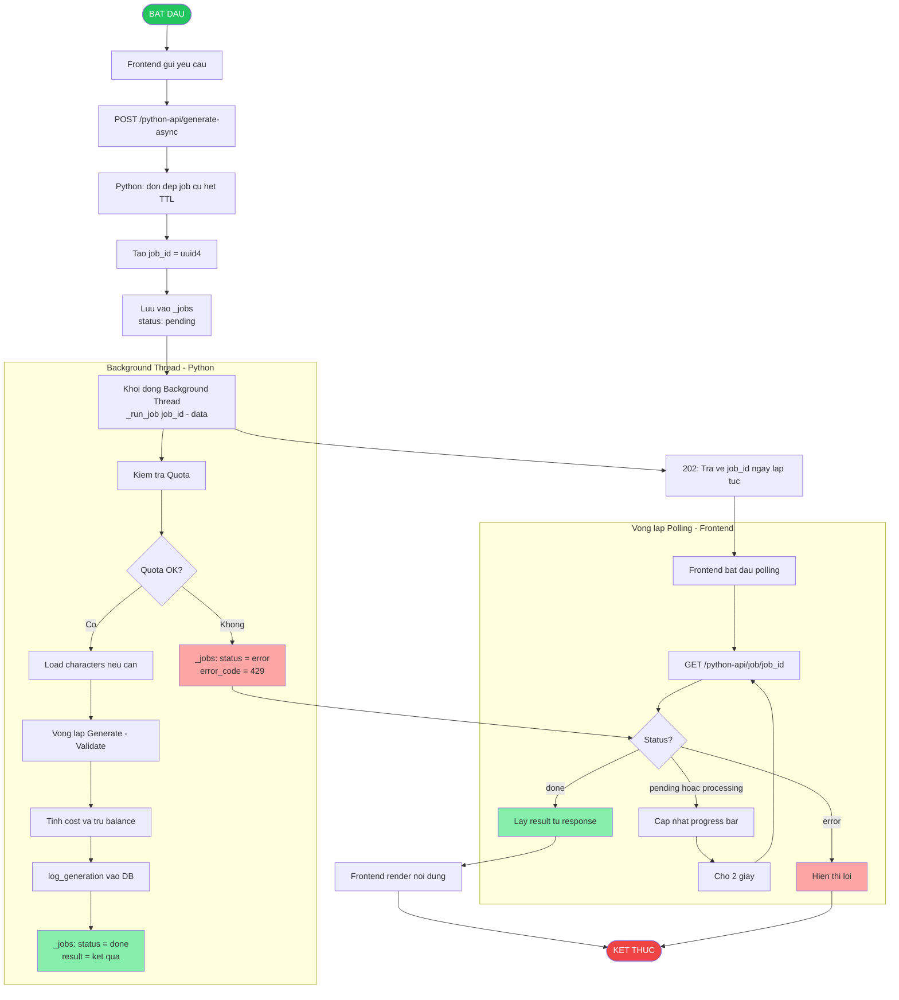
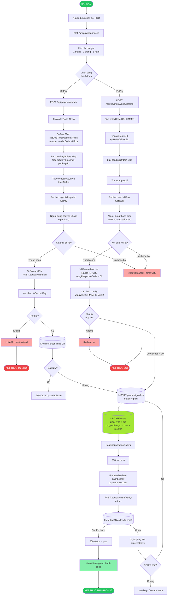
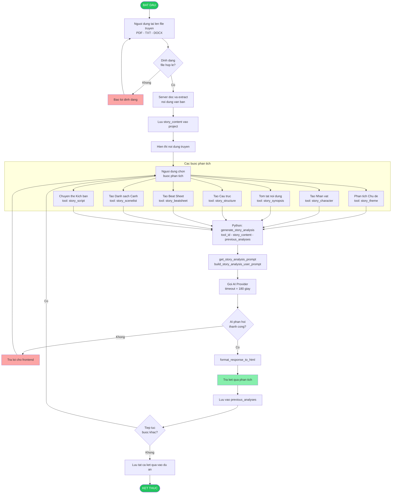
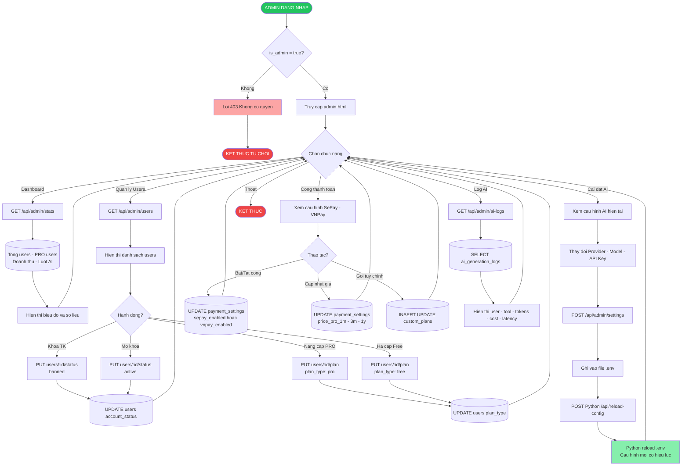
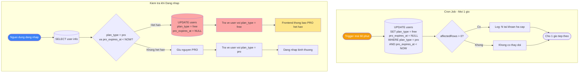

# Sơ Đồ Hoạt Động — Hệ Thống AI Screenplay

---

## 1. Hoạt Động: Đăng Ký Tài Khoản

---

## 2. Hoạt Động: Đăng Nhập (Email/Password & Google OAuth)

---

## 3. Hoạt Động: Quên Mật Khẩu (OTP)

---

## 4. Hoạt Động: Tạo Nội Dung AI (Đồng Bộ - Có Retry)

---

## 5. Hoạt Động: Tạo Nội Dung AI Bất Đồng Bộ (Async Job)

---

## 6. Hoạt Động: Thanh Toán & Nâng Cấp PRO

---

## 7. Hoạt Động: Pipeline 8 Bước Tạo Kịch Bản

```mermaid
flowchart TD
    Start([BAT DAU]) --> P0[Nguoi dung nhap y tuong phim]

    subgraph B1 ["Buoc 1: Logline"]
        P0 --> S1A[Dien movie_idea - genre - tone]
        S1A --> S1B[AI tao Logline]
        S1B --> S1C{Validate OK?}
        S1C -->|Khong dat| S1D[Retry voi feedback]
        S1D --> S1B
        S1C -->|Dat| S1E[Luu Logline]
    end

    subgraph B2 ["Buoc 2: Chu de"]
        S1E --> S2A[AI xac dinh Chu de<br/>dua tren Logline]
        S2A --> S2B{Validate OK?}
        S2B -->|Khong dat| S2C[Retry]
        S2C --> S2A
        S2B -->|Dat| S2D[Luu Theme]
    end

    subgraph B3 ["Buoc 3: Nhan vat"]
        S2D --> S3A[AI tao danh sach nhan vat]
        S3A --> S3B{Validate OK?}
        S3B -->|Khong dat| S3C[Xoa JSON cu - Retry]
        S3C --> S3A
        S3B -->|Dat| S3D[Luu nhan vat vao JSON files]
        S3D --> S3E[Nhan vat san sang]
    end

    subgraph B4 ["Buoc 4: Synopsis"]
        S3E --> S4A[Load characters tu JSON]
        S4A --> S4B[AI viet Synopsis<br/>Logline + Theme + Characters]
        S4B --> S4C{Validate OK?}
        S4C -->|Khong dat| S4D[Retry]
        S4D --> S4B
        S4C -->|Dat| S4E[Luu Synopsis]
    end

    subgraph B5 ["Buoc 5: Cau truc 4 Hoi"]
        S4E --> S5A[AI tao cau truc 4 hoi]
        S5A --> S5B{Validate OK?}
        S5B -->|Khong dat| S5C[Retry]
        S5C --> S5A
        S5B -->|Dat| S5D[Luu Structure]
    end

    subgraph B6 ["Buoc 6: Beat Sheet"]
        S5D --> S6A[AI tao Beat Sheet]
        S6A --> S6B{Validate OK?}
        S6B -->|Khong dat| S6C[Retry]
        S6C --> S6A
        S6B -->|Dat| S6D[Luu Beatsheet]
    end

    subgraph B7 ["Buoc 7: Danh sach Canh"]
        S6D --> S7A[AI tao Scene List]
        S7A --> S7B{Validate OK?}
        S7B -->|Khong dat| S7C[Retry]
        S7C --> S7A
        S7B -->|Dat| S7D[Luu Scenelist]
    end

    subgraph B8 ["Buoc 8: Viet Kich ban"]
        S7D --> S8A[Chon canh can viet]
        S8A --> S8B[AI viet kich ban chi tiet]
        S8B --> S8C{Validate OK?}
        S8C -->|Khong dat| S8D[Retry]
        S8D --> S8B
        S8C -->|Dat| S8E[Kich ban hoan chinh]
    end

    S8E --> SAVE[(Luu vao ai_responses)]
    SAVE --> EXPORT{Xuat file?}
    EXPORT -->|Co| EXP[Xuat PDF hoac DOCX hoac TXT]
    EXPORT -->|Khong| End([KET THUC])
    EXP --> End

    style Start fill:#22c55e,color:#fff
    style End fill:#22c55e,color:#fff
    style SAVE fill:#a3e635
    style S1E fill:#86efac
    style S2D fill:#86efac
    style S3E fill:#86efac
    style S4E fill:#86efac
    style S5D fill:#86efac
    style S6D fill:#86efac
    style S7D fill:#86efac
    style S8E fill:#86efac
```

---

## 8. Hoạt Động: Phân Tích Truyện → Kịch Bản (Story Mode)

---

## 9. Hoạt Động: Quản Trị Hệ Thống (Admin)

---

## 10. Hoạt Động: Tự Động Hạ Cấp PRO Hết Hạn

---

> **Lưu ý:** Tất cả các luồng AI (sơ đồ 4, 5, 7, 8) đều đi qua Python Flask API (port 5000) được proxy bởi Node.js (port 3000) qua đường dẫn `/python-api/*`.

> **Cơ chế Validate & Retry** là trọng tâm của hệ thống: mỗi lần tạo nội dung AI đều tự động kiểm tra chất lượng. Nếu không đạt, hệ thống gửi feedback cho AI và thử lại tối đa `MAX_RETRIES` lần trước khi trả về kết quả tốt nhất.
