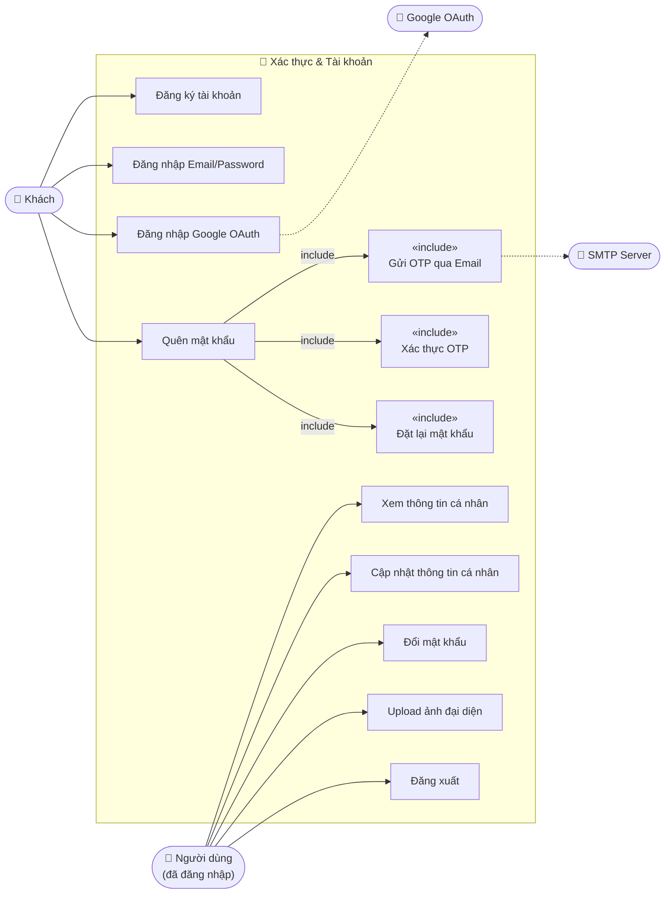
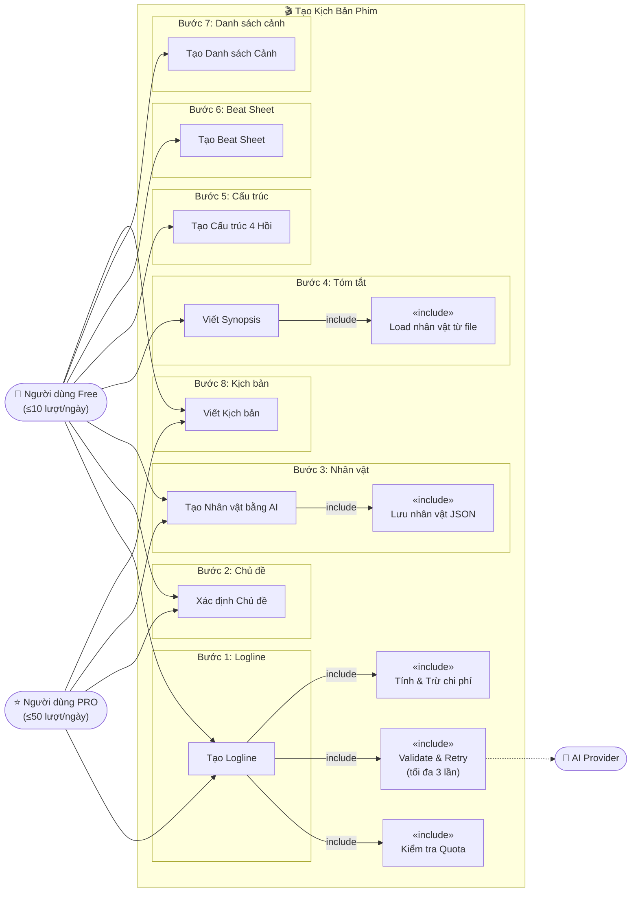
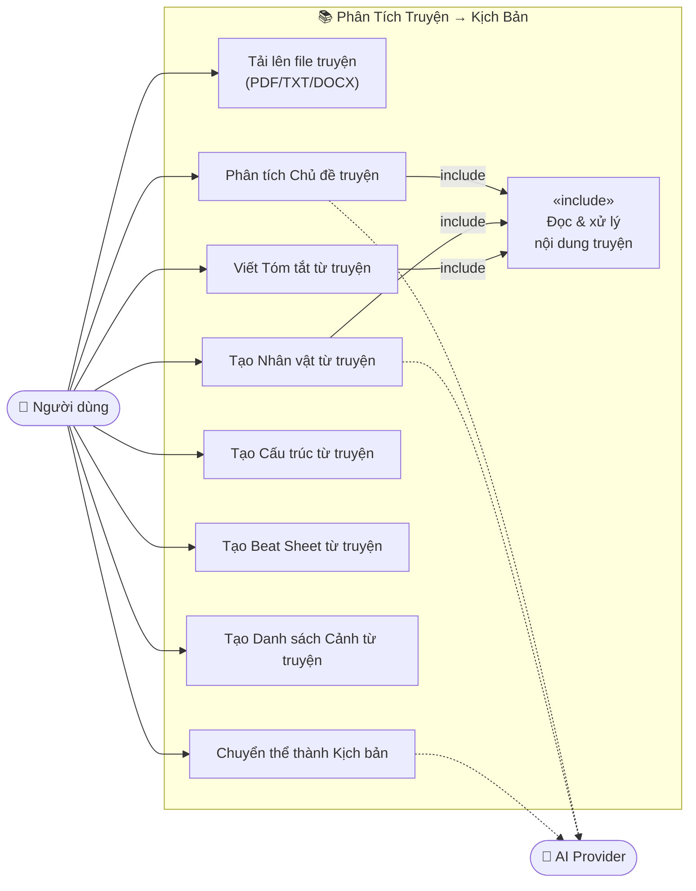
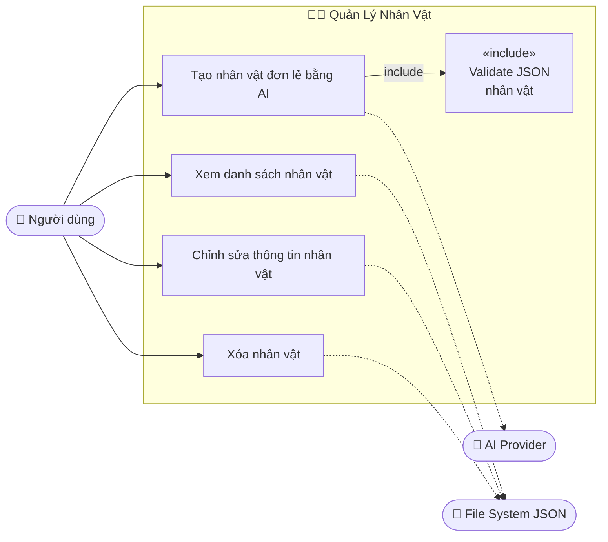
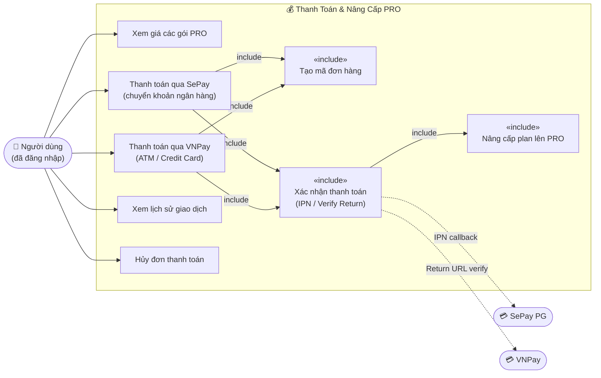
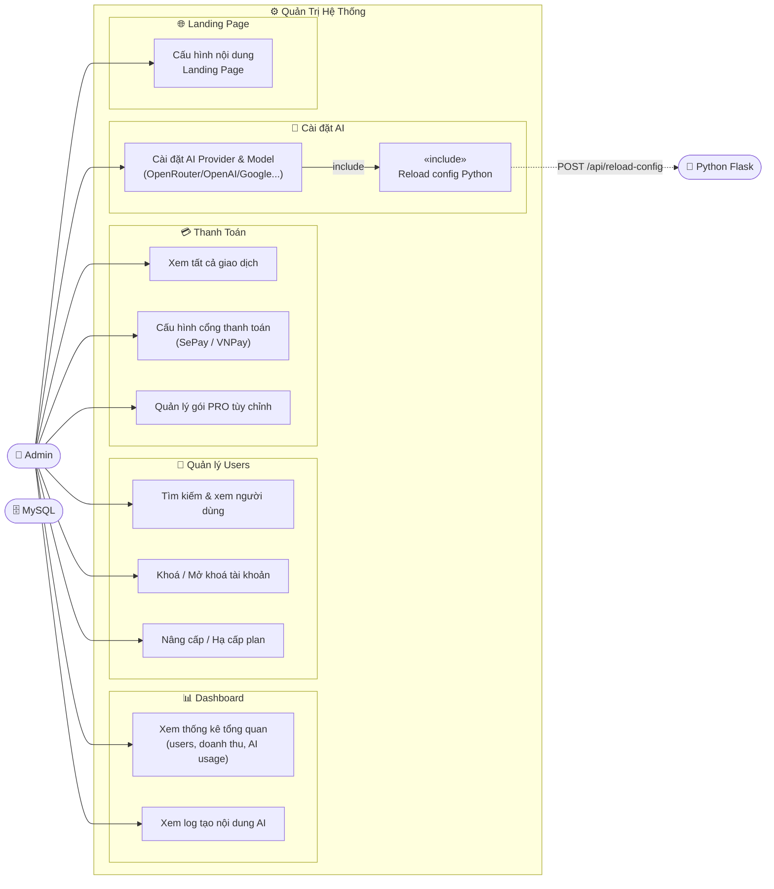

# Sơ Đồ Use Case — Hệ Thống AI Screenplay

## Tổng Quan Actors

| Actor | Mô tả |
|-------|-------|
| 👤 **Khách (Guest)** | Người dùng chưa đăng nhập |
| 🙍 **Người dùng Free** | Đã đăng nhập, gói miễn phí (tối đa 10 lượt AI/ngày) |
| ⭐ **Người dùng PRO** | Đã đăng nhập, gói trả phí (tối đa 50 lượt AI/ngày) |
| 👑 **Admin** | Quản trị viên hệ thống |
| 🤖 **Hệ thống AI** | Actor bên ngoài: OpenRouter / OpenAI / Anthropic / Google |
| 💳 **Cổng thanh toán** | SePay PG / VNPay |

---

## Sơ Đồ Use Case Tổng Quát

```mermaid
graph TB
    subgraph Actors["👥 Actors"]
        Guest["👤 Khách\n(Guest)"]
        FreeUser["🙍 Người dùng Free"]
        ProUser["⭐ Người dùng PRO"]
        Admin["👑 Admin"]
        AISystem["🤖 AI Provider"]
        Payment["💳 Cổng Thanh toán"]
    end

    subgraph Auth["🔐 Xác thực & Tài khoản"]
        UC1["Đăng ký tài khoản"]
        UC2["Đăng nhập Email/Password"]
        UC3["Đăng nhập Google OAuth"]
        UC4["Quên mật khẩu (OTP)"]
        UC5["Xem thông tin cá nhân"]
        UC6["Cập nhật thông tin cá nhân"]
        UC7["Đổi mật khẩu"]
        UC8["Upload ảnh đại diện"]
    end

    subgraph AI_Screenplay["🎬 Tạo Kịch Bản Phim"]
        UC10["Tạo Logline"]
        UC11["Xác định Chủ đề"]
        UC12["Tạo Nhân vật bằng AI"]
        UC13["Viết Tóm tắt (Synopsis)"]
        UC14["Tạo Cấu trúc 4 Hồi"]
        UC15["Tạo Beat Sheet"]
        UC16["Tạo Danh sách Cảnh"]
        UC17["Viết Kịch bản"]
    end

    subgraph AI_Story["📚 Phân Tích Truyện có sẵn"]
        UC20["Tải lên file truyện"]
        UC21["Phân tích Chủ đề truyện"]
        UC22["Tạo Nhân vật từ truyện"]
        UC23["Viết Tóm tắt từ truyện"]
        UC24["Tạo Cấu trúc từ truyện"]
        UC25["Tạo Beat Sheet từ truyện"]
        UC26["Tạo Danh sách Cảnh từ truyện"]
        UC27["Viết Kịch bản từ truyện"]
    end

    subgraph Character["🧑‍🎭 Quản lý Nhân vật"]
        UC30["Xem danh sách nhân vật"]
        UC31["Tạo nhân vật đơn lẻ bằng AI"]
        UC32["Chỉnh sửa thông tin nhân vật"]
        UC33["Xóa nhân vật"]
    end

    subgraph Project["📁 Quản lý Dự án"]
        UC40["Tạo dự án mới"]
        UC41["Xem danh sách dự án"]
        UC42["Mở / tiếp tục dự án"]
        UC43["Lưu kết quả AI vào dự án"]
        UC44["Xóa dự án"]
        UC45["Xuất kịch bản ra file"]
    end

    subgraph Pay["💰 Thanh toán & Gói PRO"]
        UC50["Xem giá các gói PRO"]
        UC51["Thanh toán qua SePay"]
        UC52["Thanh toán qua VNPay"]
        UC53["Xem lịch sử giao dịch"]
        UC54["Hủy đơn thanh toán"]
    end

    subgraph AdminArea["⚙️ Quản trị Hệ thống"]
        UC60["Xem dashboard thống kê"]
        UC61["Quản lý người dùng"]
        UC62["Khoá / Mở khoá tài khoản"]
        UC63["Nâng cấp / Hạ cấp plan user"]
        UC64["Xem lịch sử giao dịch toàn hệ thống"]
        UC65["Cấu hình cổng thanh toán"]
        UC66["Cài đặt AI Provider & Model"]
        UC67["Quản lý gói tùy chỉnh"]
        UC68["Xem log tạo nội dung AI"]
        UC69["Cấu hình Landing Page"]
    end

    %% Guest
    Guest --> UC1
    Guest --> UC2
    Guest --> UC3
    Guest --> UC4
    Guest --> UC50

    %% Free User
    FreeUser --> UC5
    FreeUser --> UC6
    FreeUser --> UC7
    FreeUser --> UC8
    FreeUser --> UC10
    FreeUser --> UC11
    FreeUser --> UC12
    FreeUser --> UC13
    FreeUser --> UC14
    FreeUser --> UC15
    FreeUser --> UC16
    FreeUser --> UC17
    FreeUser --> UC20
    FreeUser --> UC21
    FreeUser --> UC22
    FreeUser --> UC23
    FreeUser --> UC24
    FreeUser --> UC25
    FreeUser --> UC26
    FreeUser --> UC27
    FreeUser --> UC30
    FreeUser --> UC31
    FreeUser --> UC32
    FreeUser --> UC33
    FreeUser --> UC40
    FreeUser --> UC41
    FreeUser --> UC42
    FreeUser --> UC43
    FreeUser --> UC44
    FreeUser --> UC45
    FreeUser --> UC51
    FreeUser --> UC52
    FreeUser --> UC53
    FreeUser --> UC54

    %% PRO inherits Free
    ProUser -.->|kế thừa| FreeUser

    %% Admin
    Admin --> UC60
    Admin --> UC61
    Admin --> UC62
    Admin --> UC63
    Admin --> UC64
    Admin --> UC65
    Admin --> UC66
    Admin --> UC67
    Admin --> UC68
    Admin --> UC69

    %% External systems
    AISystem -.->|cung cấp kết quả| UC10
    AISystem -.->|cung cấp kết quả| UC12
    Payment -.->|xác nhận giao dịch| UC51
    Payment -.->|xác nhận giao dịch| UC52
```

---

## Chi Tiết Use Case Theo Phân Hệ

### 🔐 Phân Hệ Xác Thực & Tài Khoản

---

### 🎬 Phân Hệ Tạo Kịch Bản Phim (Screenplay Mode)

---

### 📚 Phân Hệ Phân Tích Truyện (Story Mode)

---

### 🧑‍🎭 Phân Hệ Quản Lý Nhân Vật

---

### 💰 Phân Hệ Thanh Toán & Nâng Cấp PRO

---

### ⚙️ Phân Hệ Quản Trị (Admin)

---

## Bảng Tổng Hợp Use Case & Actor

| Use Case | Guest | Free | PRO | Admin |
|----------|:-----:|:----:|:---:|:-----:|
| Đăng ký tài khoản | ✅ | | | |
| Đăng nhập | ✅ | | | |
| Đăng nhập Google OAuth | ✅ | | | |
| Quên mật khẩu (OTP) | ✅ | | | |
| Xem thông tin cá nhân | | ✅ | ✅ | ✅ |
| Cập nhật thông tin / Avatar | | ✅ | ✅ | |
| Đổi mật khẩu | | ✅ | ✅ | |
| **Tạo Logline** | | ✅ | ✅ | |
| **Xác định Chủ đề** | | ✅ | ✅ | |
| **Tạo Nhân vật AI** | | ✅ | ✅ | |
| **Viết Synopsis** | | ✅ | ✅ | |
| **Tạo Cấu trúc 4 Hồi** | | ✅ | ✅ | |
| **Tạo Beat Sheet** | | ✅ | ✅ | |
| **Tạo Danh sách Cảnh** | | ✅ | ✅ | |
| **Viết Kịch bản** | | ✅ | ✅ | |
| **Phân tích Truyện (Story mode)** | | ✅ | ✅ | |
| Quản lý Nhân vật (CRUD) | | ✅ | ✅ | |
| Quản lý Dự án (CRUD) | | ✅ | ✅ | |
| Xuất kịch bản ra file | | ✅ | ✅ | |
| Xem giá gói PRO | ✅ | ✅ | ✅ | |
| Thanh toán SePay / VNPay | | ✅ | ✅ | |
| Xem lịch sử giao dịch | | ✅ | ✅ | |
| Quota AI: 10 lượt/ngày | | ✅ | | |
| Quota AI: 50 lượt/ngày | | | ✅ | |
| Dashboard thống kê | | | | ✅ |
| Quản lý Users (ban/unban) | | | | ✅ |
| Cấu hình AI Provider | | | | ✅ |
| Cấu hình cổng thanh toán | | | | ✅ |
| Xem log AI generation | | | | ✅ |
| Quản lý gói tùy chỉnh | | | | ✅ |
| Cấu hình Landing Page | | | | ✅ |

---

> [!NOTE]
> **PRO** kế thừa toàn bộ quyền của **Free**, nhưng có quota cao hơn (50 vs 10 lượt AI/ngày) và không bị giới hạn một số tính năng cao cấp.

> [!IMPORTANT]
> **Admin** không sử dụng các tính năng AI thông thường (tạo kịch bản, thanh toán...). Admin chỉ quản trị hệ thống và có thể trực tiếp nâng cấp plan cho bất kỳ user nào qua giao diện Admin.
